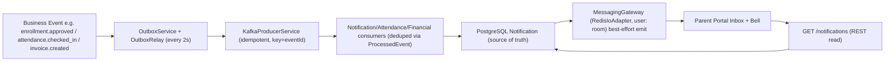

# Phase 7 — Parent Communication: Notifications Inbox & Real-Time

Date: 2026-11-07 · Stack: NestJS12/Prisma7/Kafka/Redis/Socket.IO/Next16

## Architecture (existing, reused)

- **Model (unchanged):** `Notification{id,userId FK cascade,type,channel,title,body,link?,readAt?,createdAt}` + index `[userId,readAt]`. No migration.
- **Consumers (unchanged):** `NotificationEventConsumer (notification.requested → GENERAL, enrollment.* → ENROLLMENT /parent/applications, incident → INCIDENT)`, `AttendanceEventConsumer`, `FinancialEventConsumer`, `MessagingService.createMessage → MESSAGE`. Email consumers run parallel (dry-run tests).
- **Socket:** `MessagingGateway /messaging`, `WsJwtGuard` (JWT `tv/mustChangePassword`), joins `user:<id>` on connect, `RedisIoAdapter` for fan-out. `CHAT_SERVER_EVENTS.NOTIFICATION="notification:new"`.

## API (new `notifications/` module)
| Method | Endpoint | Auth | Behavior |
|---|---|---|---|
| `GET` | `/notifications?status=all|unread|read&type&page&pageSize` | `JwtAuthGuard` (any auth) | `where {userId: user.id, readAt, type}` paginated `toPage`, select `id/type/channel/title/body/link/readAt/createdAt` |
| `GET` | `/notifications/unread-count` | auth | `{unread: count where readAt=null}` |
| `PATCH` | `/notifications/:id/read` | auth | `findFirst{id,userId}` → `404` else `updateMany{readAt:null}` idempotent |
| `PATCH` | `/notifications/read-all` | auth | `updateMany{userId,readAt:null}` → `{updated}` |

Identity only from `@CurrentUser()`; no body/query userId. `GET :id` intentionally **not** implemented (list-only, detail via PATCH).

## Read/unread
- Persisted `readAt` drives UI; Socket never marks read (delivery ≠ read). Idempotent `updateMany` (0-row no error).

## Socket delivery
- `NotificationsService.notify(userId,row)` best-effort `server.to(userRoom).emit(notification:new, {notification})`; `MessagingGateway` injected optionally — `undefined` in worker (no Server) → no-op. Offline users get REST on reconnect (PG truth). Avoids duplicate DB (emit after insert, single writer).

## Outbox/Kafka
- No new topics/consumers. Outbox relay 2s, DLQ `.dlq`, retries 3/5 preserve. Deferral = inbox appears after consumer commit.

## Authorization matrix
| Role | List/count/read |
|---|---|
| All authenticated | own only (`userId==id`), else `404` |
| Unauth | `401` |

## UI (`notifications-inbox.tsx`)
- `NotificationBell` (header): unread badge + recent preview (hover), `useSocket` → `notification:new` live `unread+1` + prepend, REST fallback refresh.
- `NotificationsInbox` (`/parent/notifications`): status/category filters (server `?status&type&page`), pagination, loading/empty/error, per-row `Mark read`, header `Mark all`, `Open` safe `link` (e.g. `/parent/applications`). Bell in `portal-workspace` header for all portals (scoped by user).

## Security
- Ownership-scoped queries, IDOR-safe `404`, no sensitive payload (title/body/link only), no logs of body.

## Tests (actual)
- `api notifications.service.spec` 5 passed (scope, unread+type, count, markRead 404, markAll).
- Full gates: see final report.

## Files
- `apps/api/src/notifications/{controller,service,module}.ts`, `app.module.ts`
- `apps/api/src/notifications/notifications.service.spec.ts`
- `apps/web/src/components/notifications-inbox.tsx`, `portal-workspace.tsx` (bell+inbox)

## Limitations
- No prefs, no delete, no push when worker-only (REST fallback); chat `notification:new` payload shares name — inbox handler tolerates both shapes.
